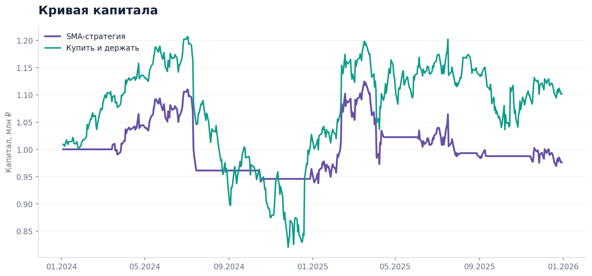
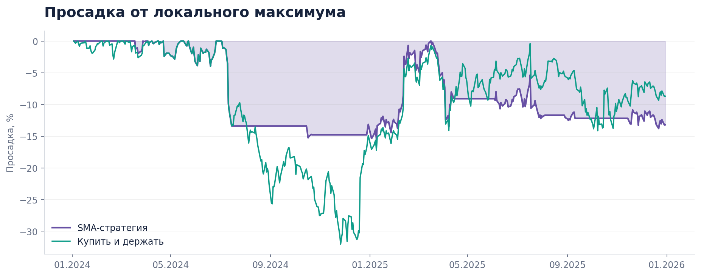

# SBER: SMA 20 / 50

Период: 2024-01-03 — 2025-12-30; сессий: 510.
Источник данных: **iss_cache**; независимая сверка: **PASS**.

## Ключевые метрики

| Метрика | SMA | Купить и держать |
|---|---:|---:|
| Итоговый капитал | 976 041 ₽ | 1 101 849 ₽ |
| Доходность | -2.40% | +10.18% |
| CAGR | -1.21% | +4.99% |
| Макс. просадка | -15.52% | -32.03% |
| Sharpe (rf=0) | -0.0127 | 0.3008 |
| Закрытые сделки | 7 | 1 |
| Win rate | 14.29% | — |

## Где стратегия работает плохо

### Доходность

**Стратегия отстала от «купить и держать» на 12.58 п.п.**

Смена режима по SMA не компенсировала пропущенные движения и издержки на выбранном периоде.

### Риск

**Максимальная просадка -15.52% (2024-07-02 → 2025-01-09).**

Даже выход в денежные средства не исключил существенного снижения капитала.

### Качество сигналов

**Прибыльны только 14.29% закрытых сделок.**

На боковых участках пересечения SMA могут давать повторные убыточные входы и выходы.

### Доходность на риск

**Sharpe при нулевой безрисковой ставке: -0.01.**

Доходность слабо компенсирует дневную волатильность на этом историческом интервале.

### Неблагоприятный режим

**Худший календарный год — 2024: -3.61%.**

Проверь этот режим отдельно; один агрегированный результат скрывает неоднородность.

## Независимая сверка

Сравнено 510 точек и 7 сделок. Максимальное расхождение капитала: 0.0 ₽; PnL: 0.0 ₽.

## Допущения

- Сигнал по закрытию дня исполняется по открытию следующего торгового дня
- Только long: 0% или 100% доступного капитала, целое число акций, без плеча и налогов
- Открытая позиция закрывается по цене close последнего дня; дивиденды не учитываются

## Цена ↔ новости

Новости показаны как контекст рядом с крупными движениями цены. Это не доказательство причины движения.

### 2024-12-20: +12.49%

- [Рынок акций РФ рванул вверх на решении ЦБ не менять ставку](https://www.interfax.ru/business/999819) — Интерфакс, 2024-12-20

### 2025-02-12: +6.78%

- [Акции Сбербанка перешли к уверенному росту после разговора Путина и Трампа](https://1prime.ru/20250212/sberbank-854887500.html) — ПРАЙМ, 2025-02-12

### 2025-10-16: +6.76%

- [Прогноз по цене акций Сбербанка. Мощный скачок на геополитике](https://bcs-express.ru/tehanaliz/sber/17.10.25) — БКС Экспресс, 2025-10-17

### 2024-07-11: -6.57%

- [Рынок акций РФ открылся снижением индексов МосБиржи и РТС на 2%](https://www.interfax.ru/business/970295) — Интерфакс, 2024-07-11

### 2025-04-04: -5.54%

- [Акции Сбербанка SBER упали на 5,49% до 285,51 ₽](https://bcs-express.ru/profit/post/598384b0-6b93-4dc8-8a87-82f714c0b536) — БКС Экспресс, 2025-04-04

## Ограничения

- Исследован один тикер и один набор параметров; оптимизация по всей истории повышает риск подгонки.
- Не моделировались налоги, дивиденды, проскальзывание, частичное исполнение и ограничения ликвидности.
- Sharpe рассчитан по дневной доходности с нулевой безрисковой ставкой и годовизацией √252.
- Сопоставление новостей и цены — только календарное и лексическое, без утверждения причинности.

> Это исследование на исторических данных, а не инвестиционная рекомендация. Прошлая доходность не гарантирует будущую. Результат чувствителен к допущениям, комиссиям, налогам, ликвидности и качеству данных.
